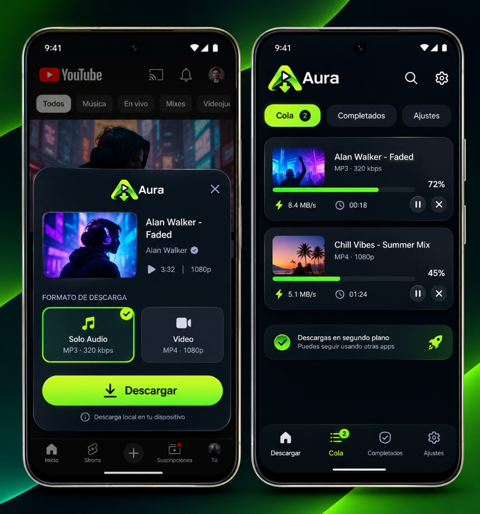

<div align="center">
  
  <h1>Aura Media</h1>
  <p><strong>Download. Listen. Watch.</strong></p>
  <p>
    Descargador nativo de audio y video para Android en <strong>Flutter + Material 3</strong>.<br/>
    100% local en tu dispositivo, con modal rápido flotante al compartir desde YouTube, carpetas separadas para MP3/MP4 y descargas persistentes en segundo plano.
  </p>

  <p>
    <a href="https://github.com/TheWiche/aura-media/releases/latest">
      
    </a>
    
    
    
  </p>
</div>

---

<div align="center">
  
</div>

---

## ✨ Características principales

### ⚡ Modal rápido al compartir (sin salir de YouTube)
* Al compartir un video desde **YouTube** o cualquier navegador hacia **Aura**, se abre una `Activity` translúcida (`ShareModalActivity`) directamente encima de la aplicación de origen sin lanzar la interfaz completa.
* Preselecciona **Solo Audio** por defecto para descargar en un toque y vuelve automáticamente a YouTube al iniciar la descarga.
* Configurable desde **Ajustes** entre tres modos: **Modal rápido**, **Auto-descarga instantánea** o **Abrir app completa**.

### 🎧 Extracción local y formatos diferenciados
* **100% en el dispositivo:** sin servidores externos ni APIs intermedias (`youtube_explode_dart` vía `oEmbed` + Innertube y extractor directo HTTP para archivos web).
* **Extracción nativa en Android:** `MediaExtractor` + `MediaMuxer` en Kotlin extraen la pista de audio sin depender de binarios pesados de FFmpeg.
* **Audio (`MP3` / `M4A`) y Video (`MP4`):** selector de calidades (`Mejor`, `1080p`, `720p`, `480p`, `360p`) con tamaños estimados reales antes de descargar.

### 📂 Carpetas separadas y gestión inteligente de archivos
* **Rutas independientes** para **Audio** (`Download/AuraMedia/Audio` por defecto) y **Video** (`Download/AuraMedia/Video` por defecto) configurables mediante el selector nativo de carpetas de Android (`ACTION_OPEN_DOCUMENT_TREE`).
* Descargas temporales aisladas en caché (`getTemporaryDirectory`) para no dejar archivos `.tmp` incompletos en tus carpetas finales.
* Política configurable ante duplicados (**Renombrar `(1)`** o **Sobrescribir**), opción para incluir el nombre del autor/canal (`Autor - Título`) e indexado automático en **Galería y reproductores de música** (`MediaScannerConnection`).

### 🔄 Cola persistente en segundo plano
* Ejecución aislada en el `ForegroundService` de Android (`flutter_foreground_task`) con persistencia local (`TaskPersistenceService`): **las descargas siguen activas incluso si cierras el modal rápido o la app principal**.
* Controles individuales para **pausar, reanudar, cancelar y reintentar**, límite configurable de descargas simultáneas (`1`–`4`), notificaciones con progreso en tiempo real y modo **Solo descargar con Wi-Fi**.

### 🎨 Sistema de diseño Aura Core 1.0
* **Material 3** con soporte completo para tema **Sistema**, **Oscuro** (Grafito `#101210` + Lima `#C1F36B`) y **Claro** (`#F5F7F1` + `#527B13`).
* Distinción cromática consistente entre **Audio (verde `#80DB78` / `#26834B`)** y **Video (violeta azulado `#A5B4FC` / `#555FC1`)**.
* Tipografías empaquetadas localmente en `assets/google_fonts/` para uso sin conexión: **Plus Jakarta Sans** (títulos), **Inter** (interfaz) y **JetBrains Mono** (velocidades, porcentajes, ETA y tamaños).

---

## 📱 Descarga e instalación (APK)

1. Ve a la sección de [**Releases**](https://github.com/TheWiche/aura-media/releases/latest) y descarga **`aura_v1.3.0_arm64.apk`** (optimizado para dispositivos Android ARM64 modernos).
2. Instala el APK en tu dispositivo Android.
3. En **Ajustes** dentro de la app podrás conceder:
   * **Permiso de almacenamiento / Acceso a todos los archivos** (necesario en Android 11+ si deseas guardar en carpetas personalizadas como `Music/` o `Movies/`).
   * **Exención de optimización de batería** para descargas largas en segundo plano.

---

## 🏗️ Arquitectura del proyecto

```text
lib/
├── core/
│   ├── constants/              # Constantes globales y claves de preferencias
│   ├── services/               # Settings, Storage, Permissions, Notifications,
│   │                           # BackgroundService (TaskHandler), NativeBridge,
│   │                           # TaskPersistence y ShareIntent
│   ├── theme/                  # Aura Core 1.0 (aura_colors, aura_typography,
│   │                           # aura_dimensions, aura_theme)
│   └── utils/                  # Formateadores de bytes, velocidad, ETA y nombres
├── features/
│   ├── downloader/             # Extractores (YouTube/Web), modelos, BLoC, cola y
│   │                           # pantallas Descargar / Cola / Completados
│   ├── settings/               # Pantalla integral de Ajustes
│   └── share_modal/            # Entrypoint y UI del modal rápido translúcido
├── shared/
│   ├── navigation/             # AuraBottomNavigation
│   └── widgets/                # AuraButton, AuraCard, AuraProgress,
│                               # AuraFormatSelector, AuraDownloadCard
└── main.dart                   # Entrypoints main() y shareModalMain()

android/app/src/main/kotlin/com/mediasdownload/medias_download/
├── AuraApplication.kt          # FlutterEngineGroup y registro de plugins en segundo plano
├── MainActivity.kt             # Activity principal de la app
├── ShareModalActivity.kt       # Activity translúcida exclusiva para ACTION_SEND
└── NativeBridge.kt             # MediaExtractor/Muxer, DocumentTree, MediaScanner, Wi-Fi
```

---

## 🛠️ Desarrollo y compilación

### Requisitos
* **Flutter:** `3.44.2` o superior (Dart SDK `^3.12.2`)
* **JDK:** Java `17` (recomendado para Gradle `8.11.1` / AGP `8.7.3`)
* **Android SDK** configurado (`android/local.properties`)

### Comandos principales

```bash
# Instalar dependencias
flutter pub get

# Análisis estático
flutter analyze

# Ejecutar suite de pruebas (23 tests unitarios y de widgets)
flutter test

# Compilar APK de producción para ARM64
flutter build apk --release --target-platform android-arm64
```

> **Nota en Windows:** Si tu variable global `JAVA_HOME` apunta a un JDK más reciente (p. ej. JDK 25), ejecuta Gradle/Flutter usando JDK 17 en la sesión de terminal antes de compilar.

---

## 🧪 Pruebas

La suite en [`test/`](test/) cubre:
* [`aura_design_system_test.dart`](test/aura_design_system_test.dart): tokens de `AuraColors`, temas `AuraTheme.dark` / `light` y componentes `AuraButton`, `AuraFormatSelector`, `AuraDownloadCard` y `AuraBottomNavigation`.
* [`settings_storage_and_modal_test.dart`](test/settings_storage_and_modal_test.dart): persistencia de ajustes, carpetas separadas MP3/MP4, política de duplicados, serialización de `DownloadTask` y flujo completo de `ShareModalScreen`.
* [`extraction_and_queue_test.dart`](test/extraction_and_queue_test.dart) y [`live_extraction_verification_test.dart`](test/live_extraction_verification_test.dart): detección y limpieza de URLs, formateadores y ciclo de vida de `DownloadQueueManager`.
* [`widget_test.dart`](test/widget_test.dart): smoke test de arranque completo de `AuraApp`.

---

## ⚠️ Aviso legal

Esta herramienta está pensada únicamente para uso personal y descarga de contenido de libre acceso o sobre el cual cuentes con los derechos correspondientes. Respeta siempre las condiciones de servicio de cada plataforma y los derechos de autor.
